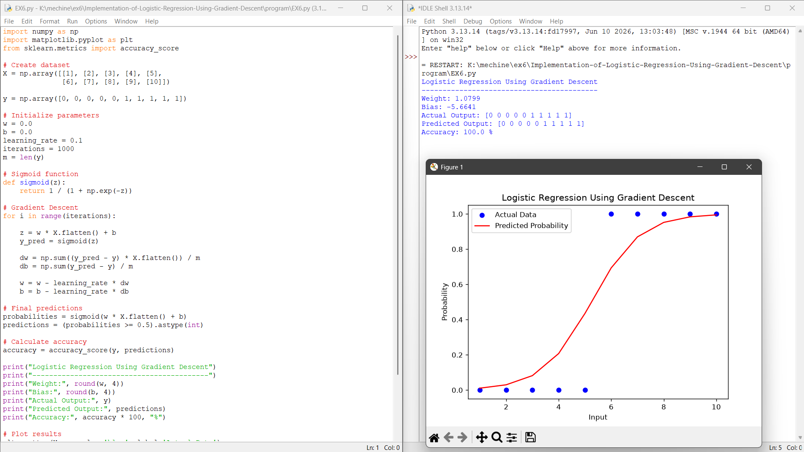

# Implementation-of-Logistic-Regression-Using-Gradient-Descent

## AIM:
To write a program to implement the the Logistic Regression Using Gradient Descent.

## Equipments Required:
1. Hardware – PCs
2. Anaconda – Python 3.7 Installation / Jupyter notebook

## Algorithm
1. Import the required libraries such as NumPy, Matplotlib, and Scikit-learn.
2. Generate or load a dataset and initialize the weights and bias with zero values.
3. Apply the sigmoid function and use Gradient Descent to update the weights and bias iteratively.
4. Predict the output using the trained model and display the results.

## Program:
```
import numpy as np
import matplotlib.pyplot as plt
from sklearn.metrics import accuracy_score

# Create dataset
X = np.array([[1], [2], [3], [4], [5],
              [6], [7], [8], [9], [10]])

y = np.array([0, 0, 0, 0, 0, 1, 1, 1, 1, 1])

# Initialize parameters
w = 0.0
b = 0.0
learning_rate = 0.1
iterations = 1000
m = len(y)

# Sigmoid function
def sigmoid(z):
    return 1 / (1 + np.exp(-z))

# Gradient Descent
for i in range(iterations):

    z = w * X.flatten() + b
    y_pred = sigmoid(z)

    dw = np.sum((y_pred - y) * X.flatten()) / m
    db = np.sum(y_pred - y) / m

    w = w - learning_rate * dw
    b = b - learning_rate * db

# Final predictions
probabilities = sigmoid(w * X.flatten() + b)
predictions = (probabilities >= 0.5).astype(int)

# Calculate accuracy
accuracy = accuracy_score(y, predictions)

print("Logistic Regression Using Gradient Descent")
print("------------------------------------------")
print("Weight:", round(w, 4))
print("Bias:", round(b, 4))
print("Actual Output:", y)
print("Predicted Output:", predictions)
print("Accuracy:", accuracy * 100, "%")

# Plot results
plt.scatter(X, y, color='blue', label='Actual Data')
plt.plot(X, probabilities, color='red',
         label='Predicted Probability')
plt.xlabel("Input")
plt.ylabel("Probability")
plt.title("Logistic Regression Using Gradient Descent")
plt.legend()
plt.show()

```

## Output:




## Result:
Thus the program to implement the the Logistic Regression Using Gradient Descent is written and verified using python programming.